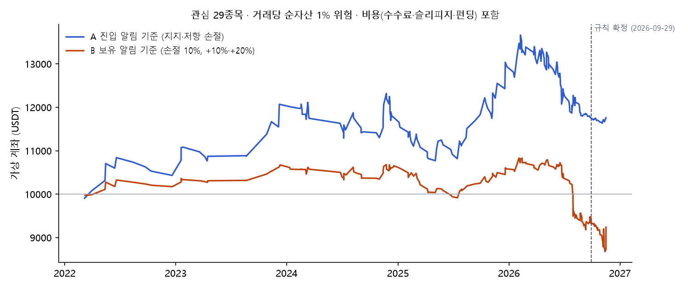

# 다중 시간봉 스윙 알림 규칙 백테스트

제가 직접 만들어 쓰던 바이낸스 선물 스윙 알림 서비스의 규칙을, 실제 알림 코드 그대로 과거 시세에 돌려 본 검증입니다.
알림 서비스는 2026년 9월에 만들어 Discord 알림을 받고, 매우 적은 금액으로 직접 주문해 운영해 봤습니다.
그때는 규칙이 맞는지 과거 데이터로 확인하지 않은 채 썼기 때문에, 이번에 비용을 넣고 다시 확인했습니다.

## 가설

> 일봉·4시간봉 추세가 같은 방향일 때, 1시간 추세·이평 정배열·ADX·RSI·MACD·거래량 8개 조건 중 6개 이상이 맞고
> 15분봉에서 5/25 이평 교차나 25선 회복이 나오면, 그 방향으로 들어가는 것이 아무 때나 들어가는 것보다 낫다.

## 무엇을 돌렸나

| 항목 | 내용 |
|---|---|
| 종목 | 알림 서비스 관심 목록 29개: 코인 3개(BTC·ETH·ENA), 주식·원자재 토큰 26개(NVDA·AMD·MU·PLTR·INTC·CL 등) |
| 기간 | 2022-01 ~ 2026-11-15 (주식 토큰은 2026년 상장 후부터) |
| 데이터 | 바이낸스 USD-M 공개 시세, 15분·1시간·4시간·일봉, 실제 펀딩비 (`src/fetch.py`, 키 없음) |
| 신호 | 원본 코드 `analyze_frames`·`apply_entry_gates`·`structure_levels`를 **고치지 않고** 불러 씀 (`vendor/`, 커밋 fb4887a) |
| 진입 | 알림이 난 15분봉 다음 봉 시가. 같은 종목에 포지션이 있으면 새 알림은 건너뜀 |
| 청산 A | 진입 알림에 적힌 손절(가까운 지지·저항 너머, 최대 10%)과 목표가 1·2 |
| 청산 B | 보유 감시 알림 규칙: 평균가 대비 10% 손절, +10%·+20%에서 1/3씩 익절 |
| 공통 | 남은 물량은 '차트 훼손' 알림(4시간 추세 반대, 또는 1시간·15분 모두 반대) 다음 시가에 정리, 최대 21일 |
| 비용 | 수수료 편도 0.05%, 시장가 체결 슬리피지 0.02%, 실제 펀딩비. 같은 봉에서 손절·익절이 다 닿으면 손절 먼저 |
| 계좌 | 원본 수량 규칙: 손절 시 순자산 1% 손실, 전체 명목 3배 한도, 손실 20%면 신규 진입 잠금 |

규칙은 2026-09-29에 확정했고 그 뒤로 바꾸지 않았습니다. 그래서 **2026-09-29 이후 7주**는 규칙을 만들 때 보지 못한 구간입니다.
이 검증에서 결과를 보고 기준값을 다시 맞추지 않았습니다.

## 결과



| | 거래 | 승률 | 평균 R | 손익비(PF) | 가상 계좌 1만 → | 최대 낙폭 |
|---|---:|---:|---:|---:|---:|---:|
| A 진입 알림 기준 | 296 | 34.1% | +0.057 | 1.07 | 11,758 (+17.6%) | 14.9% |
| B 보유 알림 기준 | 260 | 38.8% | −0.029 | 0.90 | 9,238 (−7.6%) | 19.9% |

R은 손절폭 대비 손익(1R = 손절 한 번)입니다. 계좌는 서로 겹치는 포지션의 한도를 적용해, 거래 수가 표보다 적습니다(A 211건, B 260건).

**나눠 보면**

| | A 평균 R (PF) | B 평균 R (PF) |
|---|---|---|
| 코인 3개 | +0.267 (1.27) | +0.082 (1.34) |
| 주식·원자재 토큰 26개 | −0.153 (0.83) | −0.154 (0.53) |
| 규칙 확정 전 | +0.037 (0.99) | −0.030 (0.89) |
| 규칙 확정 후 7주 | +0.154 (1.54), 49건 | −0.024 (0.93), 44건 |
| 롱 / 숏 | +0.086 / +0.026 | +0.035 / −0.087 |

**비용을 늘리면** (수수료·슬리피지 배수)

| 배수 | ×0 | ×1 | ×2 | ×3 |
|---|---:|---:|---:|---:|
| A 평균 R | +0.136 | +0.057 | −0.020 | −0.094 |
| B 평균 R | −0.015 | −0.029 | −0.042 | −0.056 |

**무작위와 비교 (B, 200번)** — 같은 종목에서 같은 수만큼, 일봉·4시간 추세 방향으로 아무 때나 들어가고 같은 규칙으로 청산하면
무작위 평균 R은 −0.006(5~95%: −0.053 ~ +0.043)이었고, 200번 중 76.5%가 전략보다 좋았습니다.
방향까지 무작위로 해도 75.5%가 전략보다 좋았습니다.

**기준을 바꿔 보면 (B)** — 최소 점수 6·7·8개, 손익비 기준 1.0~3.0, 손절 폭 5~15% 어디에서도 평균 R이 0을 넘지 않았습니다
(가장 좋은 값을 고르려는 것이 아니라, 결과가 기준에 따라 얼마나 흔들리는지 본 것입니다).

## 읽은 것

1. **B(보유 알림 기준)는 비용 전에도 손실**이고, 아무 때나 들어간 것보다 나았다고 할 수 없습니다. 진입 조건 8개가 수익에 더해 준 것이 확인되지 않았습니다.
2. **A(진입 알림 기준)는 조금 이익**이지만 중앙 R이 −1(대부분 손절)이고, 일부 큰 이익 거래에 기대며, 비용이 2배면 0이 됩니다. 남길 수 있다고 보기 어렵습니다.
3. **같은 서비스 안에서 손절 규칙이 두 개**였습니다. 진입 알림은 지지·저항 손절(평균 약 2~3%)을 알려 주는데, 보유 감시는 평균가 10% 손절로 다시 계산합니다. 백테스트로 두 규칙의 결과가 크게 다르다는 것을 확인했고, 하나로 정해야 합니다.
4. **주식 토큰에서 손실이 컸습니다.** 상장 몇 달 된 상품이라 표본이 짧고, 미국 장이 닫힌 시간에도 24시간 거래되는 점이 영향을 줬을 수 있습니다(확인 안 함).
5. **규칙 확정 후 7주**는 거래 44~49건이라 이 결과만으로 판단하기에 짧습니다.

## 한계

- 원본은 알림 순간의 호가로 손절·목표를 계산합니다. 과거에는 호가가 없어 신호 봉 종가로 계산하고, 다음 봉 시가에 진입했습니다.
- 분할 추가매수(2·3차), 실제 사람이 알림을 보고 주문하기까지의 지연, 호가 대기열·부분 체결은 넣지 않았습니다.
- 차트 훼손 판단은 빠른 계산으로 따로 구현했고, 원본 `frame_features`와 무작위 1,200개 시점에서 100% 일치하는 것을 확인했습니다 (`src/parity.py`).
- 코인 3개가 같은 시기에 함께 움직여 거래들이 서로 독립이 아닙니다.
- 옵션 체인 점수는 과거 데이터가 없어 넣지 않았습니다.

## 다시 돌리기

```bash
pip install pandas numpy httpx pydantic matplotlib
python -X utf8 src/fetch.py      # 공개 시세 내려받기 (약 25MB)
python -X utf8 src/signals.py    # 원본 규칙으로 신호 판정 → results/signals.csv.gz
python -X utf8 src/report.py     # 거래·비용·기간·민감도·무작위 비교 → results/summary.json
python -X utf8 src/chart.py      # docs/equity.png
python -X utf8 src/parity.py BTCUSDT NVDAUSDT
```

이 저장소는 주문을 넣지 않고, 키를 쓰지 않습니다. 결과는 투자 권유가 아닙니다.
