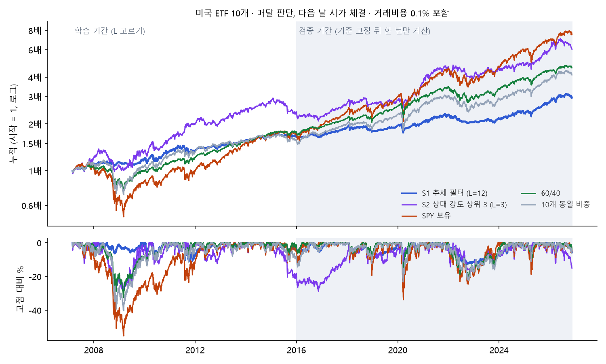

# 미국 ETF 추세추종 검증

스윙 알림 백테스트에서 "직접 쓰던 단타 규칙은 비용을 넣으면 남지 않는다"는 결론이 나와,
데이터가 길고 경제적 이유가 있는 가설로 바꿔 다시 검증했습니다.
**설계는 결과를 보기 전에 [DESIGN.md](DESIGN.md)에 고정했고, 그 뒤로 바꾸지 않았습니다.**

## 가설
- H1 추세가 꺾인 자산을 단기채(SHY)로 바꿔 두면, 그냥 들고 있을 때보다 낙폭이 작고 위험 대비 성과가 낫다.
- H2 추세가 가장 강한 3개만 고르면 H1보다 수익은 높지만 흔들림도 크다.
- H3 (대학생 모의투자 때 쓴 생각) 기준금리를 내리는 구간에는 금·원자재가 주식보다 낫다.

## 방법
| 항목 | 내용 |
|---|---|
| 자산 | 미국 상장 ETF 10개: SPY QQQ IWM EFA EEM VNQ GLD DBC TLT IEF, 현금 대용 SHY |
| 데이터 | yfinance 일봉(배당·분할 반영) 2004-01 ~ 2026-11-16, 기준금리 FRED FEDFUNDS |
| 규칙 | 매달 마지막 거래일 종가로 판단 → **다음 거래일 시가**에 체결. 추세 = 지난 L개월 수익률 > SHY |
| S1 추세 필터 | 10개에 1/10씩, 추세가 아닌 자산 몫은 SHY |
| S2 상대 강도 | L개월 수익률 상위 3개에 1/3씩, 그중 추세가 아닌 몫은 SHY |
| 비용 | 바뀐 비중만큼 0.10% (스트레스 0.20·0.30%) |
| 기준 정하기 | 학습 2007-03~2015에서 L(3·6·9·12개월) 중 샤프가 가장 높은 값 → S1 12개월, S2 3개월 |
| 검증 | 2016-01 ~ 2026-11, 고른 L 그대로 한 번만 계산 |
| 비교 | SPY 보유, 60/40, 10개 동일 비중, 동일 비중+SHY를 섞어 S1과 변동성을 같게 맞춘 것 |

## 결과



**검증 기간 2016-01 ~ 2026-11** (비용 0.1% 포함)

| | 연수익률 | 연변동성 | 샤프 | 최대 낙폭 | 최악의 해 |
|---|---:|---:|---:|---:|---:|
| S1 추세 필터 (12개월) | 5.4% | 7.8% | 0.51 | **12.6%** | −10.6% |
| S2 상대 강도 (3개월) | 9.2% | 13.6% | 0.60 | 18.1% | −14.4% |
| SPY 보유 | 14.6% | 17.7% | **0.76** | 33.7% | −18.2% |
| 60/40 | 9.2% | 10.5% | 0.75 | 21.2% | −16.6% |
| 10개 동일 비중 | 9.4% | 11.7% | 0.69 | 23.2% | −16.4% |

**학습 기간 2007-03 ~ 2015** (2008 금융위기 포함)

| | 연수익률 | 샤프 | 최대 낙폭 |
|---|---:|---:|---:|
| S1 추세 필터 | 6.0% | **0.46** | **11.0%** |
| SPY 보유 | 6.5% | 0.30 | 55.2% |
| 10개 동일 비중 | 5.3% | 0.27 | 40.2% |

**변동성을 같게 맞춰 비교** — 추세 필터가 "그냥 현금을 섞어 위험을 낮춘 것"보다 나은가

| | 학습: 연수익률 / 최대 낙폭 | 검증: 연수익률 / 최대 낙폭 |
|---|---|---|
| S1 추세 필터 | 6.0% / 11.0% | 5.4% / 12.6% |
| 동일 비중 + SHY 혼합 (S1과 같은 변동성) | 4.2% / 22.8% | 6.9% / 16.9% |

**흔들림 확인**
- 검증 기간 S1 샤프는 L=3·6·9·12개월에서 0.62·0.62·0.63·0.51. 학습에서 고른 12개월이 검증에서는 가장 낮았습니다.
- 비용을 0.1 → 0.2 → 0.3%로 올리면 S1 샤프 0.51 → 0.48 → 0.44, S2 0.60 → 0.53 → 0.45 (S2는 1년에 포트폴리오를 약 10번 갈아 비용에 약함).
- 검증 기간 샤프 차이 부트스트랩(월 수익, 12개월 블록, 2,000번): S1 − 동일 비중 −0.15 (90% 구간 −0.43 ~ +0.07), S1 − SPY −0.29 (−0.63 ~ +0.01).

**H3 금리 인하 구간** (기준금리 6개월 변화 ≤ −0.25%p, 발표 시차 2개월 반영)
- 인하 구간 49개월에 금(GLD)은 SPY보다 월평균 +1.19%p 높았지만 t값 0.97, 원자재(DBC) +0.41%p(t 0.39).
- 인하 구간이 2004년 이후 5번뿐이라 통계적으로 확인됐다고 말할 수 없습니다. 방향은 모의투자 때 생각과 같았습니다.

## 읽은 것
1. **H1의 절반만 맞았습니다.** 추세 필터는 두 기간 모두 최대 낙폭을 크게 줄였습니다(변동성을 맞춘 비교에서도 22.8→11.0%, 16.9→12.6%).
   하지만 위험 대비 성과(샤프)는 2008년이 있던 학습 기간에서만 나았고, 검증 기간에는 동일 비중·SPY보다 낮았습니다.
2. 그래서 이 필터는 **큰 하락장을 피하는 보험**에 가깝고, 보험료는 검증 기간에 동일 비중 대비 연 4%p 가량의 수익이었습니다.
   2020년처럼 빠르게 떨어졌다 오르는 하락에서는 매달 한 번 보는 12개월 추세가 늦습니다.
3. **학습 기간에서 고른 기준이 검증에서 가장 나빴습니다**(L=12). 기준을 고를 때 생기는 낙관을 그대로 보여 주는 결과라, 고른 값 하나보다 L 전체의 범위(0.51~0.63)로 판단하는 것이 맞습니다.
4. S2는 수익을 올렸지만 비용과 회전율에 약하고, SPY를 이기지 못했습니다.
5. 금리 인하 구간 금 가설은 방향은 맞지만 표본(5번의 인하 국면)이 너무 적어 결론을 내릴 수 없습니다.

## 한계
- ETF 10개는 지금 살아 있는 상품이라 생존 편향이 조금 있습니다(대신 개별 종목보다는 훨씬 작음).
- 다음 날 시가 체결과 0.1% 비용은 단순화한 가정입니다. 세금·환전 비용은 넣지 않았습니다.
- 검증 기간 10년은 미국 주식이 아주 강했던 시기라, 주식 비중을 줄이는 전략에 불리했습니다.

## 다시 돌리기
```bash
pip install pandas numpy yfinance matplotlib
python -X utf8 etf/fetch_etf.py
python -X utf8 etf/backtest_etf.py   # → results/etf/summary.json, equity.csv
python -X utf8 etf/chart_etf.py      # → docs/etf_equity.png
```
